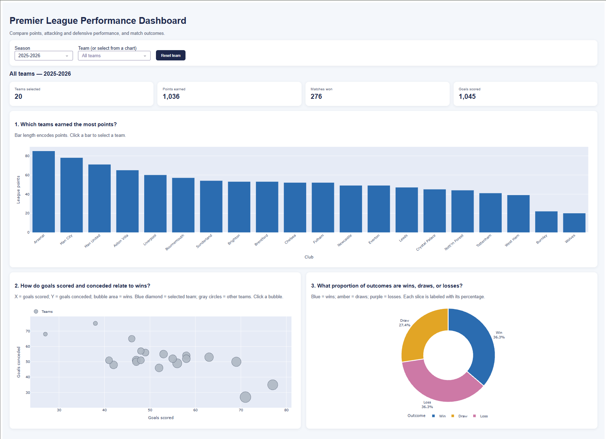
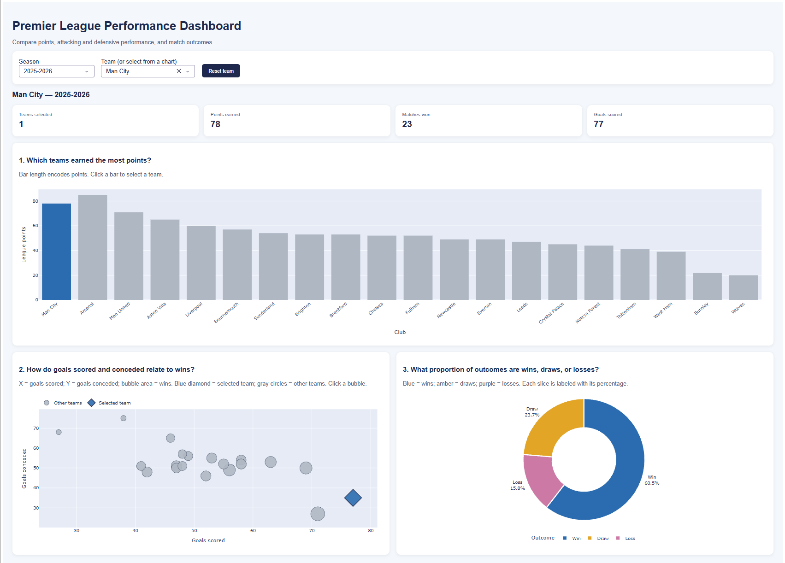

# Premier League Performance Dashboard

**Mini-Project 2 — Interactive Dashboard | Prototype**

An interactive dashboard built with **Python, Pandas, Plotly, and Dash** to explore English Premier League team performance across the **2023–2024, 2024–2025, and 2025–2026** seasons. Users can compare league points, goals scored versus goals conceded, and win/draw/loss outcomes, then select a team to coordinate the views.

> **Prototype status:** Three linked visualizations are implemented. Final refinements and peer usability testing are separate stages of the project.

## Live demo and source

- **Live dashboard:** [[Link to Deployed Dashboard](https://premier-leauge-dashboard.vercel.app/)]
- **GitHub repository:** [Github Link](https://github.com/nibishtamrakar/premier-leauge-dashboard)

Only add a live URL after opening it and confirming that the dashboard loads correctly.

## Research questions and views

| View | Research question | What it displays |
| --- | --- | --- |
| **1. Team Points Comparison** (bar chart) | Which teams earned the most points in a selected season? | Teams versus total league points. Selecting a team moves its bar to the first position and highlights it; the other teams retain their relative points ranking. |
| **2. Goals Scored vs. Conceded** (bubble scatter plot) | How does attacking and defensive performance relate to match wins? | X = goals scored, Y = goals conceded, bubble area = number of wins. Selected team = blue diamond with dark outline; other teams = gray circles. |
| **3. Match Outcomes** (donut chart) | What proportions of a team's matches end in wins, draws, or losses? | Win, draw, and loss counts and percentages for the selected team, or aggregated **team-match outcomes** when no team is selected. |

**Note on aggregation:** The team-level data has two records per Premier League match (one per club). With *All teams* selected, the donut counts outcomes from both teams' perspectives, not unique matches. In that state, every draw contributes two draw outcomes, and a decisive match contributes one win and one loss.

## Dataset

**Source:** [Football-Data.co.uk — England match results](https://www.football-data.co.uk/englandm.php). The project downloads Premier League (`E0.csv`) match records for three seasons:

- 2023–2024 (`2324/E0.csv`)
- 2024–2025 (`2425/E0.csv`)
- 2025–2026 (`2526/E0.csv`)

The match-level fields include `Date`, `HomeTeam`, `AwayTeam`, `FTHG`, `FTAG`, `FTR`, `HS`, `AS`, `HST`, and `AST`. Derived team-level fields include `Season`, `Team`, `Opponent`, `Venue`, `GoalsFor`, `GoalsAgainst`, `Outcome`, `Points`, and `GoalDifference`.

### Data preparation

`prepare_data.py`:

1. Downloads and combines the three source season files.
2. Parses dates and converts goal/shot fields to numeric values.
3. Removes rows missing essential match information or containing invalid result codes, and removes duplicate fixtures.
4. Calculates match total goals and readable match outcomes.
5. Reshapes each fixture into **two team-performance rows** (home and away) and calculates three points for a win, one for a draw, and zero for a loss, plus goal difference.
6. Writes `data/premier_league_matches.csv` and `data/premier_league_teams.csv`.

The dashboard reads **`data/premier_league_teams.csv`** and further aggregates it by season and team. An ordinary completed 20-team season contains 380 fixtures / 760 team-match rows; check the actual import output rather than assuming every downloaded file is complete.

### Data dimensions and visual encodings

| Dimension | Type | Encoding | Rationale |
| --- | --- | --- | --- |
| Team | Nominal | Text labels / category position | Makes clubs identifiable without assigning numerical meaning. |
| League points | Quantitative | Bar length and common vertical scale | Supports accurate magnitude comparisons. |
| Goals scored | Quantitative | Scatterplot horizontal position | Supports precise comparison along a shared axis. |
| Goals conceded | Quantitative | Scatterplot vertical position | Allows direct comparison against attacking output. |
| Wins | Quantitative | Scatterplot **marker area** | Adds a third measure to the plot; hover provides exact values. |
| Match outcome | Nominal | Donut segment color **plus text label** | Differentiates categories without relying on color alone. |
| Season | Ordered temporal category | Dropdown filter | Enables meaningful comparison by season without mixing season totals. |

**Accessibility choices:** The scatterplot uses blue (`#0072B2`) and gray (`#AEB8C4`) plus **diamond versus circle shape** and outline to identify the selected team. The donut uses blue for wins (`#0072B2`), amber for draws (`#E69F00`), and reddish purple for losses (`#CC79A7`), with direct labels, percentages, and hover values. These colors are based on the Okabe–Ito color-blind-conscious palette. The selected team moves to the first position in the points chart as an interaction cue; note that this intentionally overrides strict league order for that one bar.

## Interactive features

- **Season dropdown:** Updates the summary cards and all three charts; clears any team selection.
- **Team dropdown:** Filters the view to a selected club while keeping comparisons visible in the first two charts.
- **Bar chart click:** Selects a team, moves its bar first, and updates the scatterplot and donut.
- **Scatterplot click:** Selects a team and updates the points chart and donut.
- **Reset team:** Returns to the all-teams view for the selected season.
- **Hover tooltips:** Provide exact values for points, goals, wins, and outcomes.

**Linked views:** Selection is coordinated from the bar and scatter charts through the shared team-selection dropdown. Full bidirectional brushing is planned for the final project, not required for this prototype.

## Run locally (Windows / Cursor)

**Prerequisites:** Python 3.13 (or a compatible recent Python 3 version) and Cursor or another code editor.

From the project directory in the Cursor terminal (PowerShell):

```powershell
python -m venv venv
.\venv\Scripts\Activate.ps1
python -m pip install -r requirements.txt
```

If the CSV files are not already present in `data/`, generate them with an internet connection:

```powershell
python .\prepare_data.py
```

Start the dashboard:

```powershell
python .\app.py
```

Open **http://127.0.0.1:8050/** in your browser. Stop the server with **Ctrl+C**.

The `requirements.txt` file should include `pandas`, `plotly`, and `dash` (plus any other packages imported by the project).

## Deploy on Vercel

This project's `app.py` exposes the underlying Flask WSGI application as `app`, so Vercel can import `app:app`, while `python app.py` runs the local Dash development server.

1. Push the project, `requirements.txt`, and **`data/premier_league_teams.csv`** to GitHub. Do **not** commit `venv/`.
2. In [Vercel](https://vercel.com/new), import the GitHub repository; select the project root as the root directory.
3. Deploy, then test the resulting URL (including selecting a bar and a scatter bubble).
4. If the deployment shows a `500` error, review **Vercel → Project → Logs** for the Python traceback. Confirm that the repository contains the CSV and exports a Flask application as `app`.

A working hosted link is preferable, but the prototype rubric also accepts a repository with setup instructions.

## Project files

```text
premier-league-dashboard/
├── app.py                         # Dash charts, layout, and callbacks
├── prepare_data.py                # Download and clean source data
├── requirements.txt               # Python dependencies
├── README.md                      # This document
├── .gitignore                      # Excludes local environment/cache
├── data/
│   ├── premier_league_matches.csv  # Clean match-level data
│   └── premier_league_teams.csv    # Two team-performance rows per match
└── screenshots/
    ├── dashboard_overview.png      # Add before submission
    └── team_selection.png          # Add before submission
```

## Prototype rubric alignment

| Criterion | Evidence |
| --- | --- |
| **1. Data loaded and prepared (4 pts)** | Real, multi-season Premier League CSV data; cleaning and aggregation described above. |
| **2. Three distinct views (4 pts)** | Points bar chart, goals/wins bubble scatterplot, and outcome donut; each addresses a research question. |
| **3. Four or more dimensions encoded (4 pts)** | Team, points, goals scored, goals conceded, wins, outcomes, and season, with channels justified above. |
| **4. Basic interaction and linking (4 pts)** | Cross-chart team selection, season filter, reset, and detailed hover tooltips. |
| **5. Peer feedback (4 pts)** | Live demonstration and separate feedback log (maximum half a page), completed after the in-class session. |

### Prototype verification checklist

- [ ] Dashboard starts locally and renders three views using the real dataset.
- [ ] Season filter updates charts and clears the old team selection.
- [ ] Bar click selects a team and moves its bar to the first position.
- [ ] Scatter click selects a team and updates the other views.
- [ ] Donut categories have distinct colors, labels, and counts on hover.
- [ ] Live Vercel URL loads, **or** repository instructions work on a clean local setup.
- [ ] One or two screenshots are committed and linked below.
- [ ] In-class live demo is completed and peer feedback log is submitted.

## Screenshots

Add screenshots after testing the application:

- **Dashboard overview:** `screenshots/dashboard_overview.png` — three charts, filters, and summary cards.
- **Selected-team interaction:** `screenshots/team_selection.png` — selected club at the front of the bar chart, highlighted in the scatterplot, and reflected in the donut chart.

<!-- Uncomment after adding the actual screenshots:


-->

## Peer feedback and next steps

For the in-class session, ask peers to (1) identify the highest-point team for a season, (2) select a team and interpret its outcomes, and (3) use the scatterplot to select another team and observe linked changes. Document **who gave feedback, issues observed, and planned fixes** in a separate log of no more than **half a page**. Do not report feedback until testing has happened.

Potential final-project improvements include full linked brushing, tighter responsive layout, expanded keyboard/accessibility testing, and revisions based on actual peer observations.

## Attribution

Match data: [Football-Data.co.uk](https://www.football-data.co.uk/englandm.php). Dashboard implementation: Python, Pandas, Plotly, and Dash. The data is used for an educational visualization project.
